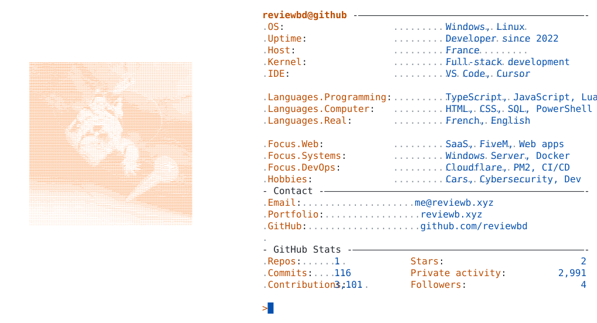

<a href="https://reviewb.xyz">
  <picture>
    <source media="(prefers-color-scheme: dark)" srcset="https://raw.githubusercontent.com/reviewbd/reviewbd/main/assets/terminal.svg">
    
  </picture>
</a>

  <a href="https://reviewb.xyz"><picture><source media="(prefers-color-scheme: dark)" srcset="https://raw.githubusercontent.com/reviewbd/reviewbd/main/assets/link_portfolio_dark.svg"></picture></a><a href="https://github.com/reviewbd"><picture><source media="(prefers-color-scheme: dark)" srcset="https://raw.githubusercontent.com/reviewbd/reviewbd/main/assets/link_github_dark.svg"></picture></a><a href="mailto:me@reviewb.xyz"><picture><source media="(prefers-color-scheme: dark)" srcset="https://raw.githubusercontent.com/reviewbd/reviewbd/main/assets/link_email_dark.svg"></picture></a>

  
  &nbsp;&nbsp;&nbsp;
  
   
  <a href="https://github.com/Addveo">Addveo</a> · <a href="https://github.com/RyvenRP">RyvenRP</a>

  

